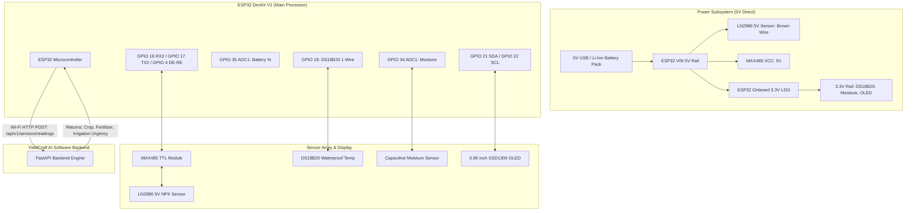

# YieldCraft AI — IoT Edge Node Hardware & Wiring Specification

This document provides complete circuit schematics, pinout connections, power management architecture, sensor calibration guidelines, and API integration details for the **YieldCraft AI ESP32 IoT Soil Monitoring Edge Node**.

---

## 1. Hardware Bill of Materials (BOM)

| Component | Purpose / Specification | Typical Operating Voltage |
| :--- | :--- | :--- |
| **ESP32 DevKit V1** | 32-bit Dual-Core MCU with 2.4 GHz Wi-Fi & Bluetooth | 3.3V Logic (5V via Micro-USB/VIN) |
| **LN2986 5V Soil NPK Sensor** | 3-probe / 7-probe RS485 Modbus RTU sensor (Nitrogen, Phosphorus, Potassium) | **5V DC (Direct from ESP32 VIN - No 12V Booster Needed!)** |
| **MAX485 Module** | TTL-to-RS485 transceiver (interfaces ESP32 UART with LN2986 Modbus) | 5V / 3.3V |
| **DS18B20 Probe** | Waterproof stainless steel digital temperature sensor (1-Wire) | 3.0V – 5.5V |
| **Capacitive Moisture Sensor** | Corrosion-resistant analog moisture sensor (v1.2 or v2.0) | 3.3V |
| **0.96" I2C OLED Display** | SSD1306 128x64 monochrome OLED for local telemetry & AI recommendations | 3.3V – 5V |
| **18650 Li-Ion Battery / Power Bank** | 3.7V 2600mAh rechargeable lithium cell or 5V USB battery pack | 3.7V / 5.0V |
| **TP4056 Module (Optional)** | USB-C Li-ion battery charging module with over-discharge protection | 5V USB in -> 4.2V battery out |
| **Resistors** | 1x 4.7kΩ (DS18B20 pull-up), 2x 100kΩ (Battery voltage divider) | 1/4 Watt |

---

## 2. Complete ESP32 Pinout & Connection Table

| ESP32 Pin | Connected Component | Module Pin | Description & Wiring Notes |
| :--- | :--- | :--- | :--- |
| **GPIO 16 (RX2)** | MAX485 TTL-to-RS485 | **RO** (Receiver Out) | UART2 RX line for receiving Modbus frames |
| **GPIO 17 (TX2)** | MAX485 TTL-to-RS485 | **DI** (Driver In) | UART2 TX line for sending Modbus query commands |
| **GPIO 4** | MAX485 TTL-to-RS485 | **DE & RE** (Tied) | Direction control (HIGH = Transmit, LOW = Receive) |
| **GPIO 18** | DS18B20 Probe | **Data** (Yellow/White) | 1-Wire Digital Bus (**4.7kΩ pull-up to 3.3V required**) |
| **GPIO 34** | Capacitive Moisture Sensor | **AOUT** | Analog input on ADC1 (works while Wi-Fi is active) |
| **GPIO 35** | Battery Voltage Divider | Midpoint of 100k/100k | Monitors battery voltage (0V–2.1V input to ADC1) |
| **GPIO 21 (SDA)** | SSD1306 0.96" OLED | **SDA** | I2C Data line |
| **GPIO 22 (SCL)** | SSD1306 0.96" OLED | **SCL** | I2C Clock line |
| **5V / VIN Pin** | **LN2986 NPK & MAX485** | **VCC** | **Direct 5V supply for LN2986 Sensor & MAX485** |
| **3.3V Out** | DS18B20, Moisture, OLED | **VCC** | Power rail for 3.3V digital and analog sensors |
| **GND** | All Modules & Sensors | **GND** | **Common Ground Reference** |

### LN2986 5V NPK Sensor Wiring:
| LN2986 Wire Color | Connects To | Description |
| :--- | :--- | :--- |
| **Brown Wire** | **ESP32 5V (VIN Pin)** | **+5V DC Power Input** |
| **Black Wire** | **ESP32 GND** | **Ground** |
| **Yellow / Green Wire** | **MAX485 Pin A** | **RS485 Differential A (+)** |
| **Blue / White Wire** | **MAX485 Pin B** | **RS485 Differential B (-)** |

---

## 3. Circuit Schematic Architecture



---

## 4. Power & Battery Management Details

1. **Battery Level Measurement (GPIO 35)**:
   - A single-cell Li-Ion battery ranges from **3.0V (dead)** to **4.2V (fully charged)**.
   - The ESP32 ADC pin cannot exceed 3.3V.
   - A voltage divider using two equal $100\text{ k}\Omega$ precision resistors cuts the voltage in half ($1.5\text{V} - 2.1\text{V}$), perfectly within the linear ADC range.
   - The firmware calculates:
     $$\text{Battery Voltage} = \frac{\text{ADC}}{4095} \times 3.3\text{V} \times 2.0$$
     $$\text{Battery Percentage} = \frac{\text{Battery Voltage} - 3.2\text{V}}{4.2\text{V} - 3.2\text{V}} \times 100\%$$

2. **Powering the 12V RS485 NPK Sensor**:
   - The soil NPK probe requires at least 9V to power its internal optical and conductivity sensing circuit.
   - Use the **MT3608 DC-DC Step-Up module**:
     - Connect `VIN+` to TP4056 `OUT+` (3.7V).
     - Connect `VIN-` to TP4056 `OUT-` (GND).
     - Rotate the MT3608 trimpot counter-clockwise with a multimeter connected to `VOUT+` until it reads **12.0V DC**.
     - Connect `VOUT+` to the NPK sensor's Power wire (Brown/Red).

---

## 5. Sensor Calibration & Configuration

### A. Capacitive Soil Moisture Sensor (GPIO 34)
Resistive soil probes corrode within weeks. The capacitive sensor uses high-frequency impedance and does not corrode.
- **Air Reading (0% Moisture)**: Hold the probe in dry air $\rightarrow \text{ADC} \approx 3200$.
- **Water Reading (100% Moisture)**: Submerge up to the white boundary line in water $\rightarrow \text{ADC} \approx 1400$.
- The firmware maps between these thresholds:
  ```cpp
  int constrainedADC = constrain(rawADC, 1400, 3200);
  float moisturePercent = map(constrainedADC, 3200, 1400, 0, 100);
  ```

### B. RS485 Modbus RTU Soil NPK Sensor
- **Baud Rate**: `9600 bps`, `8 Data bits`, `No Parity`, `1 Stop bit` (`9600 8N1`).
- **Modbus Query Frame**:
  `{0x01, 0x03, 0x00, 0x1E, 0x00, 0x03, 0x65, 0xCD}`
  - `0x01`: Slave Address
  - `0x03`: Function Code (Read Holding Registers)
  - `0x001E`: Starting register address for Nitrogen
  - `0x0003`: Number of registers to read (Nitrogen, Phosphorus, Potassium)
  - `0x65CD`: Modbus CRC16 checksum
- **Sensor Response Frame (11 Bytes)**:
  `[0x01, 0x03, 0x06, N_High, N_Low, P_High, P_Low, K_High, K_Low, CRC_High, CRC_Low]`
  Values are parsed as 16-bit integers in **mg/kg (ppm)**.

---

## 6. Software Integration with YieldCraft AI

### Telemetry Ingestion Endpoint
- **URL**: `http://<SERVER_IP>:8000/api/v1/sensors/readings`
- **Method**: `POST`
- **Request Body (from ESP32)**:
  ```json
  {
    "device_id": "ESP32_SOIL_NODE_01",
    "farm_id": "farm_001",
    "nitrogen": 85.0,
    "phosphorus": 42.0,
    "potassium": 40.0,
    "soil_moisture": 36.5,
    "soil_temperature": 24.8,
    "battery_level_pct": 88.0
  }
  ```

### Instant Response with Live Agronomic Recommendations
The YieldCraft backend automatically runs the CatBoost models against the incoming live telemetry and responds to the ESP32:
```json
{
  "reading_id": "read_a7f92b41",
  "device_id": "ESP32_SOIL_NODE_01",
  "farm_id": "farm_001",
  "status": "Ingested Successfully",
  "received_at": "2026-10-11T08:45:00Z",
  "summary": "Moisture: 36.5%, Temp: 24.8°C, NPK: 85-42-40",
  "recommended_crop": "Rice",
  "recommended_fertilizer": "Urea",
  "irrigation_need": "Low",
  "advisory_summary": "Crop: Rice | Fert: Urea | Irrig: Low"
}
```

### Dual-Screen OLED Display on the Field Device
The firmware switches between two graphical screens on the 0.96" OLED:

**Screen 1: Live Ground Telemetry**
```
+------------------------------+
| NODE: ESP32_01          88%  |
|------------------------------|
| Moisture: 36.5 %             |
| Temp:     24.8 C             |
| N: 85   P: 42   K: 40        |
| Syncing YieldCraft...        |
+------------------------------+
```

**Screen 2: Live AI Model Recommendations**
```
+------------------------------+
| YIELDCRAFT AI INSIGHT        |
|------------------------------|
| Crop:  Rice                  |
| Fert:  Urea                  |
| Irrig: Low                   |
| Moist: 37% (Live)            |
+------------------------------+
```

---

## 7. How to Flash the ESP32 Using Arduino IDE

1. Open **Arduino IDE**.
2. Go to **File** > **Preferences** and add the ESP32 board URL:
   `https://raw.githubusercontent.com/espressif/arduino-esp32/gh-pages/package_esp32_index.json`
3. Install the **ESP32 by Espressif Systems** package from the **Boards Manager**.
4. Install the required libraries from **Library Manager**:
   - `ArduinoJson` (by Benoit Blanchon, v6.x or v7.x)
   - `Adafruit SSD1306`
   - `Adafruit GFX Library`
   - `OneWire` (by Paul Stoffregen)
   - `DallasTemperature` (by Miles Burton)
5. Open `iot/yieldcraft_soil_node.ino`.
6. Update your Wi-Fi credentials and local PC IP address:
   ```cpp
   const char* WIFI_SSID     = "YOUR_WIFI_NAME";
   const char* WIFI_PASSWORD = "YOUR_WIFI_PASSWORD";
   const char* API_ENDPOINT  = "http://192.168.1.15:8000/api/v1/sensors/readings";
   const char* FARM_ID       = "YOUR_FARM_ID";
   ```
7. Select **ESP32 Dev Module** as the board and your COM port.
8. Click **Upload**.
